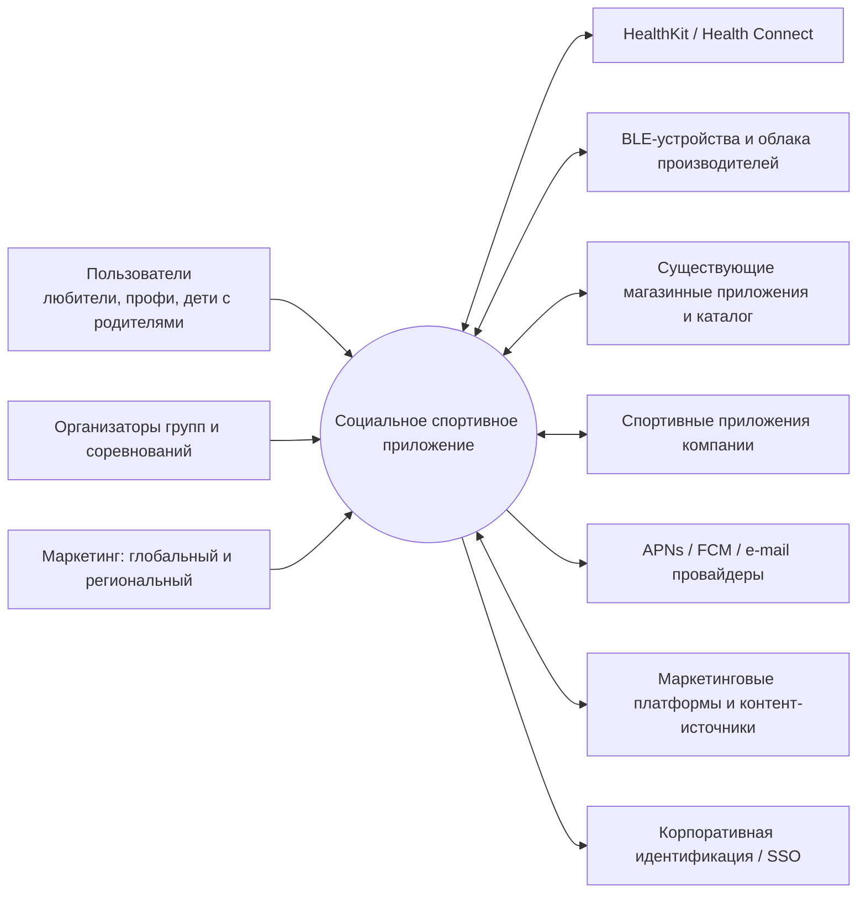
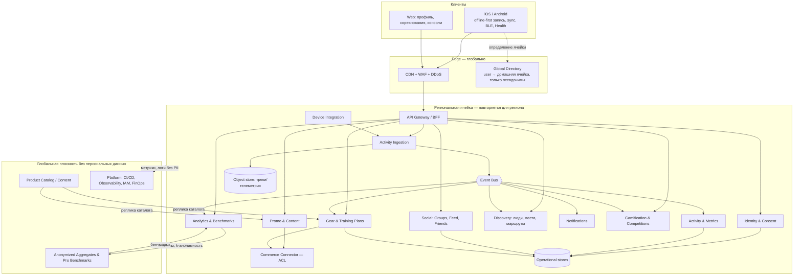

# 4. Концептуальная архитектура

[← Стейкхолдеры](03-stakeholders.md) · [Оглавление](../README.md) · [Риски →](05-risks.md)

Документ описывает *что* за части есть в системе и как они взаимодействуют на уровне идей. Детальные представления (функциональное, информационное, concurrency, инфраструктурное, безопасность) появятся на этапе 2.

## 4.1 Архитектурные принципы

1. **Privacy by design.** Минимум данных, согласие по целям, шифрование, геоданные — самый чувствительный класс.
2. **Своя ячейка — свои данные.** У каждого пользователя есть «домашний регион»; персональные данные живут в его ячейке. Между ячейками ходят только согласованные минимальные данные и анонимные агрегаты.
3. **Offline-first клиент.** Тренировка не должна зависеть от сети; сервер — приёмник событий с идемпотентностью.
4. **Выделенный ingest и real-time.** Профиль нагрузки у записи тренировок, ленты и live-соревнований разный — масштабируются независимо.
5. **События как контракт.** Домены общаются через события и API; интеграции (устройства, магазины, промо) подключаются через адаптеры (ACL), а не через ядро.
6. **Облачно-нейтральная платформа, прагматичная.** Единая платформа (Kubernetes, IaC, переносимые примитивы: Postgres-совместимая БД, Kafka-совместимая шина, S3-совместимое хранилище, Redis-совместимый кэш). Провайдер выбирается на ячейку, но не «размазываем» один сервис по нескольким облакам.
7. **Начинаем крупно, дробим по необходимости.** Укрупнённые доменные сервисы вместо десятков микросервисов (см. [опции](10-architecture-options.md)).

## 4.2 Контекст системы

## 4.3 Концептуальная схема

## 4.4 Ключевые компоненты

| Компонент | Ответственность | Владелец данных | Основные QA |
|---|---|---|---|
| Identity & Consent | Аккаунты, SSO, возраст/родитель, согласия, DSR (экспорт/удаление) | Учётные данные, согласия | QA-1 |
| Activity Ingestion | Приём пачек телеметрии, идемпотентность, валидация, сырое хранение | Сырые данные тренировок | QA-2, надёжность |
| Activity & Metrics | Нормализованные тренировки, вычисление метрик, рекорды, пробег по инвентарю | Тренировки | QA-2 |
| Analytics & Benchmarks | Сравнение с собой/регионом/профи, перцентили, агрегаты | Производные метрики | QA-1, QA-2 |
| Social | Группы, друзья, лента, комментарии, модерация | Социальный граф и контент | QA-1, QA-2 |
| Discovery | Поиск людей по интересам/месту/маршруту, статус «сейчас» | Грубые гео-индексы (по согласию) | QA-1 |
| Notifications | Правила, агрегация, троттлинг, доставка push/e-mail | Предпочтения, журнал доставки | QA-2 |
| Gamification & Competitions | Цели, значки, челленджи, live-лидерборды, античит | Прогресс, результаты | QA-2 |
| Gear & Training Plans | Инвентарь, износ, планы, календарь | Инвентарь и планы | QA-3 |
| Promo & Content | Кампании, таргетинг, региональные правила, лимиты | Кампании, отклики | QA-3, QA-1 |
| Commerce Connector (ACL) | Адаптеры к магазинным системам: каталог, deep links, атрибуция | Нет (кэш каталога) | QA-3 |
| Device Integration | Коннекторы устройств/облаков, HealthKit/Health Connect | Токены доступа | QA-3, QA-1 |
| Global Directory | Сопоставление псевдонима пользователя и ячейки | Псевдонимы и регион | QA-1 |

## 4.5 Основные потоки данных

1. **Запись тренировки:** клиент пишет локально → пачки через Gateway → Ingestion (идемпотентно) → событие `ActivityRecorded` → Activity (метрики), Gamification (достижения), Gear (пробег), Notifications (друзьям), Analytics (агрегаты).
2. **Live-соревнование:** клиент отправляет компактные пачки раз в 10–30 с → Ingestion → Competitions обновляет лидерборд в памяти → снапшоты лидерборда раздаются через CDN/кэш раз в 5 с.
3. **Рекомендация обновления обуви:** `ActivityRecorded` → Gear считает износ → событие `GearWearThreshold` → Promo выбирает предложение (по согласиям и региону) → Notifications → клик → Commerce Connector делает deep link и фиксирует атрибуцию.
4. **Путешественник:** телефон в чужом регионе отправляет данные на ближайший edge-приём, который пересылает в домашнюю ячейку; при отсутствии сети данные ждут на устройстве.

## 4.6 Как концепция отвечает на бизнес-цели

| Цель | Опорные компоненты |
|---|---|
| BG-1 сообщества | Social, Discovery, Notifications, Gamification |
| BG-2 продажи | Promo, Gear, Commerce Connector |
| BG-3 вовлечённость | Activity, Analytics, Gamification, Training Plans |
| BG-4 доверие и охват | Identity & Consent, ячейки + Directory, шифрование и аудит (на этапе 2) |

## 4.7 Границы и ограничения

- Существующие магазинные и спортивные приложения не переписываются; интеграция — только через адаптеры.
- Приложение не является медицинским изделием.
- 90% систем компании — в облаках, провайдер не фиксирован: допускаем разные провайдеры в разных ячейках, но на общей платформе.
