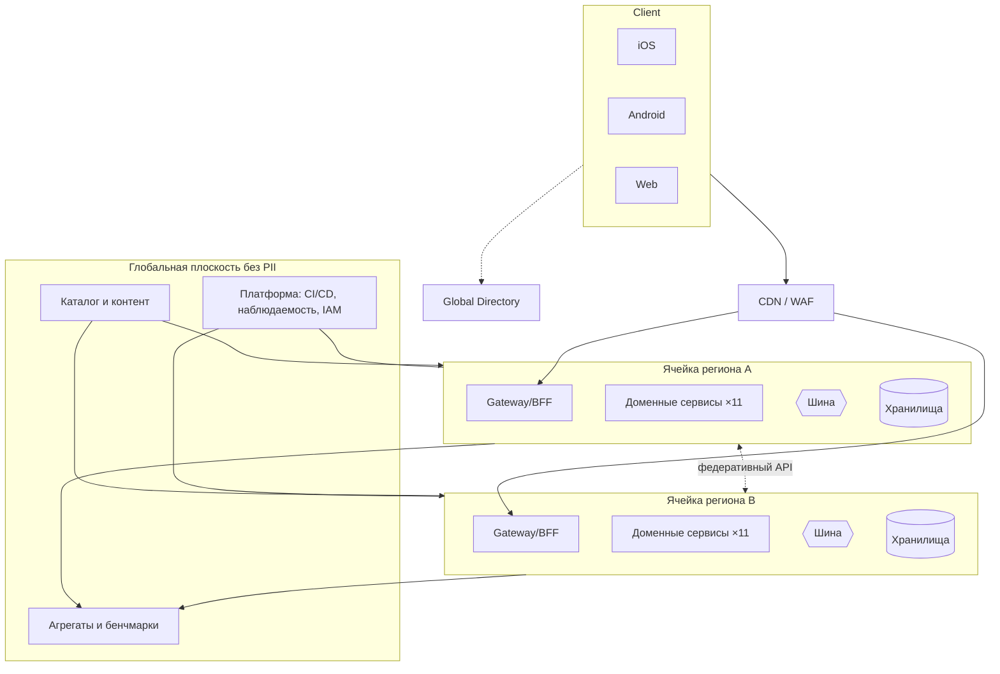

# 13. Базовая архитектура

[← Оглавление](../README.md) · Представления: [функциональное](views/14a-functional.md) · [информационное](views/14b-information.md) · [concurrency](views/14c-concurrency.md) · [инфраструктурное](views/14d-infrastructure.md) · [безопасность](views/14e-security.md)

Документ собирает решения [ADR](adr/README.md) в целостную базовую архитектуру с учётом бизнес-ограничений, [НФТ](09-nfr.md), выбранного стиля и атрибутов качества. Он углубляет [концептуальную схему](04-conceptual-architecture.md) без изменения её сути.

## 13.1 Входные ограничения

| Ограничение | Следствие |
|---|---|
| 90% систем в облаках, провайдер не фиксирован | ADR-003: платформа + провайдер на ячейку |
| Много разработчиков, разные языки | ADR-001: укрупнённые сервисы, шаблон сервиса, ограничение стека (NFR-CMP-04) |
| Существующие магазинные и спортивные приложения | ADR-010: Anti-Corruption Layer, без переписывания |
| Пользователи по всему миру, «дикие» места | ADR-002/007: ячейки и федерация; ADR-005: offline-first |
| Охрана данных | ADR-008/012; [представление безопасности](views/14e-security.md) |
| Не все требования равнозначны | [Фазы](06-roadmap.md): тяжёлые компоненты строятся по мере необходимости |

## 13.2 Обзор решения

## 13.3 Каталог сервисов

| Сервис | Тип нагрузки | Хранилище | API | События (публикует → потребляет) | Единица масштабирования |
|---|---|---|---|---|---|
| Gateway/BFF | I/O, edge | — | REST/JSON, gRPC внутри | — | по RPS |
| Identity & Consent | Малая, критичная | Реляционная | OIDC, REST | ConsentChanged, AccountDeleted | реплики + шардирование по псевдониму |
| Activity Ingestion | Пик, запись | Объектное | REST (пачки) | ChunkStored, ActivityFinalized | по лагу и RPS (автомасштабирование) |
| Activity & Metrics | Среднее | Реляционная + объектное | REST/gRPC | ActivityComputed ← ActivityFinalized | по лагу консьюмеров |
| Analytics & Benchmarks | Пакетная + чтение | Озеро, кэш | REST | AggregateUpdated ← ActivityComputed | по расписанию/объёму |
| Social | Чтение | Реляционная, кэш | REST/GraphQL | PostCreated, MembershipChanged | по чтению; кэш ленты |
| Discovery | Гео-запросы | Реляционная (гео), Redis | REST | — ← ConsentChanged, ActivityComputed | по запросам |
| Notifications | Пики после событий | Реляционная, Redis | REST, внутренний API | NotificationSent ← AchievementEarned и др. | по лагу |
| Gamification | Средняя | Реляционная, Redis | REST | AchievementEarned ← ActivityComputed | по лагу |
| Competitions | Экстремальные пики | Redis, реляционная | REST + снапшоты | CompetitionResultFinalized ← ChunkStored | по соревнованию (шарды) |
| Gear & Plans | Малая | Реляционная | REST | GearWearThreshold ← ActivityComputed | реплики |
| Promo & Content | Чтение + конфигурация | Реляционная, кэш | REST | OfferIssued ← GearWearThreshold, ActivityComputed | реплики |
| Commerce Connector | I/O внешний | Кэш | REST | Attributed | реплики; лимиты вызовов |
| Device Integration | I/O внешний | Реляционная | REST | ActivityImported | по очереди |

Языки ядра: не более трёх (NFR-CMP-04) — рекомендуется JVM-стек (Kotlin/Java) для доменных сервисов, Go для высоконагруженных ingest/gateway, Python для аналитики и ML; решение закрепляется в ADR команд платформы.

## 13.4 Правила взаимодействия

1. Синхронные вызовы: клиент → Gateway → один сервис; сервис → сервис синхронно только при необходимости чтения (с таймаутом, circuit breaker, без цепочек длиннее 2).
2. Изменения состояния распространяются событиями; публикация через outbox (ADR-009).
3. Каждый сервис — владелец своих данных; нет общего доступа к БД.
4. Межъячеечное взаимодействие — только федеративный API (ADR-007) и анонимные агрегаты.
5. Внешние системы — только через адаптеры (ADR-010).
6. Контракты API/событий версионируются; ломающие изменения — новая версия (NFR-MOD-03).

## 13.5 Как адресованы атрибуты качества

| QA | Тактики | Компоненты | ADR | НФТ |
|---|---|---|---|---|
| QA-1 Безопасность и приватность | Приватность по умолчанию; региональная изоляция данных; шифрование; mTLS; ABAC; k-анонимность; аудит; сага удаления | Identity, все хранилища, Discovery, Analytics | 002, 007, 008, 012 | SEC-01…10 |
| QA-2 Масштабируемость | Ячейки; выделенный ingest; автомасштабирование по лагу; кэш/CDN-снапшоты; шардирование лидербордов; пакетная отправка | Ingestion, Competitions, Social, Gateway | 001, 002, 004, 006, 009 | SCL-01…07 |
| QA-3 Модифицируемость | Укрупнённые сервисы с чёткими границами; события; адаптеры; конфигурируемые кампании; справочники видов спорта и коннекторов | Device Integration, Promo, Commerce Connector | 001, 010, 011, 013 | MOD-01…06 |
| Обеспечивающие: наблюдаемость | OpenTelemetry, SLO | Платформа | 014 | OBS-01…04 |
| Надёжность данных | Offline-first, идемпотентность, outbox, multi-AZ | Клиент, Ingestion | 005, 009 | REL-01…06 |

## 13.6 Покрытие функциональных требований

| Группа FR | Сервисы |
|---|---|
| FR-ID, FR-PR | Identity & Consent, Global Directory |
| FR-AR, FR-DV | Клиент, Ingestion, Device Integration, Activity |
| FR-AN | Activity & Metrics, Analytics & Benchmarks |
| FR-GR, FR-PL | Gear & Plans |
| FR-SC, FR-NT | Social, Notifications |
| FR-DS | Discovery |
| FR-GM, FR-CP | Gamification, Competitions |
| FR-PM, FR-CM | Promo & Content, Commerce Connector |
| FR-AD | Консоли (Web) над сервисами |

## 13.7 Точки эволюции

- Выделение Moderation из Social, Anti-cheat из Competitions при росте объёма.
- Включение ML-платформы для планов и рекомендаций (фаза 4).
- Чат группы как отдельный сервис (после фазы 3).
- Графовое хранилище — только при доказанной необходимости (ADR-004).

## 13.8 Известные компромиссы
См. анализ в [артефакте 15](../README.md) (этап 3); на этапе 2 зафиксированы: задержка лидерборда до 10 с (ADR-006), ограниченная аналитика между регионами (ADR-002), две нативные кодовые базы (ADR-005), сложность федерации (ADR-007).
