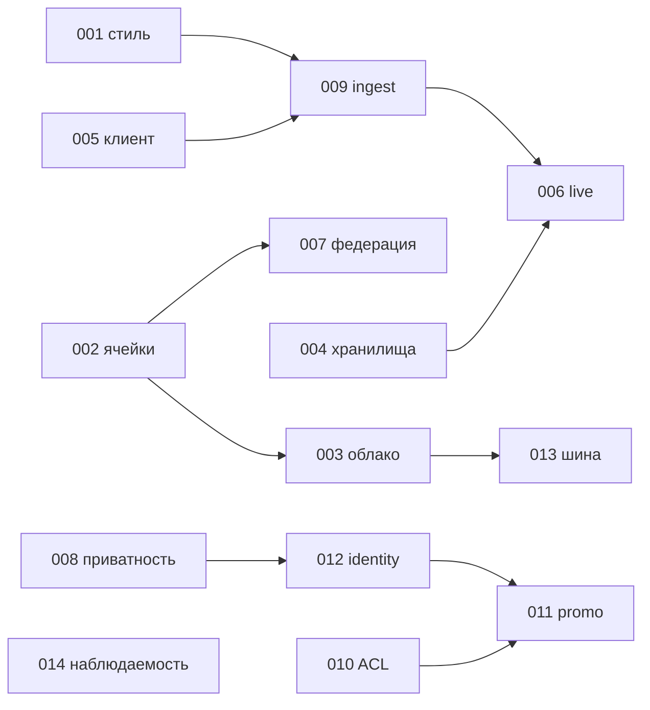

# Architecture Decision Records (ADR)

[← К оглавлению](../../README.md)

Формат: Контекст → Решение → Альтернативы → Последствия → Связи. Статус «принято» означает принято автором архитектуры и вынесено на утверждение комитетом. На ADR ссылаются из [базовой архитектуры](../13-base-architecture.md) и представлений ([views](../views/)).

| ADR | Решение | Основные QA | Источник анализа |
|---|---|---|---|
| [ADR-001](ADR-001-service-style.md) | Укрупнённые доменные сервисы + событийная шина | QA-2, QA-3 | [10.1](../10-architecture-options.md) |
| [ADR-002](ADR-002-regional-cells.md) | Региональные ячейки и домашний регион | QA-1, QA-2 | 10.2 |
| [ADR-003](ADR-003-cloud-strategy.md) | Единая платформа, провайдер на ячейку | QA-3 | 10.3 |
| [ADR-004](ADR-004-polyglot-storage.md) | Ограниченный полиглот хранилищ | QA-2 | 10.4 |
| [ADR-005](ADR-005-native-offline-client.md) | Нативные клиенты, offline-first | QA-2 | 10.5 |
| [ADR-006](ADR-006-live-competition-delivery.md) | Live-соревнования: пакеты и снапшоты | QA-2 | 10.6 |
| [ADR-007](ADR-007-cell-federation.md) | Минимальная федерация между ячейками | QA-1 | 10.2 |
| [ADR-008](ADR-008-privacy-by-default.md) | Приватность по умолчанию, k-анонимность | QA-1 | NFR-SEC |
| [ADR-009](ADR-009-idempotent-ingest.md) | Идемпотентный ingest и контракт событий | QA-2 | NFR-REL |
| [ADR-010](ADR-010-commerce-acl.md) | ACL для магазинных систем | QA-3 | R10 |
| [ADR-011](ADR-011-promo-rules-consent.md) | Promo-движок на согласиях | QA-3, QA-1 | R8, R11 |
| [ADR-012](ADR-012-identity-consent.md) | OIDC, SSO, сервис согласий | QA-1 | NFR-SEC |
| [ADR-013](ADR-013-event-bus-managed-services.md) | Kafka-совместимая шина, политика managed-сервисов | QA-2, QA-3 | RSK-15 |
| [ADR-014](ADR-014-observability-slo.md) | OpenTelemetry и SLO | QA-1, QA-2 | NFR-OBS |
| [ADR-015](ADR-015-maps-tiles.md) | Собственный тайловый сервис на открытых данных | стоимость | [TCO](../16-tco.md) |

## Как добавлять ADR
Новый файл `ADR-NNN-slug.md` по шаблону выше; изменение решения — новый ADR со статусом «заменяет ADR-XXX», старый получает статус «заменён».

## Зависимости

