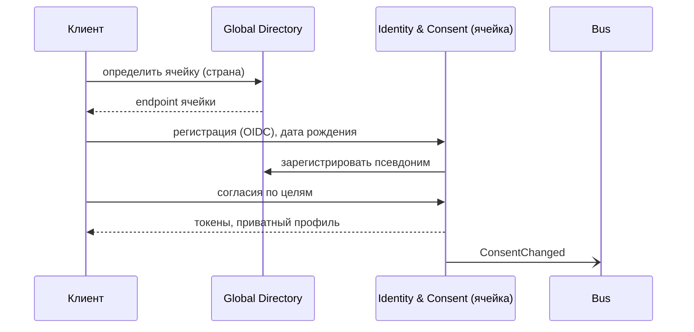

# UC-01. Регистрация, возраст и согласия

[← Индекс](README.md)

- **Актор:** новый пользователь (взрослый или несовершеннолетний), родитель.
- **Цели/требования:** BG-4; FR-ID-01…03, FR-PR-01; SC-7. **ADR:** 002, 008, 012.
- **Предусловия:** приложение установлено.
- **Основной поток:**
  1. Пользователь выбирает способ входа (SSO компании, Apple/Google, e-mail).
  2. Клиент запрашивает Global Directory: определяется домашняя ячейка (по стране; можно изменить до создания профиля).
  3. Identity создаёт аккаунт в ячейке, Directory регистрирует псевдоним → ячейка.
  4. Указывается дата рождения; для возраста ниже порога — ветка «родитель».
  5. Показываются согласия по целям (аналитика, маркетинг, геопоиск, шаринг); по умолчанию выключены, кроме необходимых для сервиса.
  6. Создаётся приватный профиль; предлагается импорт истории из Health-платформ.
- **Альтернативы:** 4a. Несовершеннолетний — приглашение родителя, ограниченный профиль до подтверждения. 2a. Страна без ячейки — назначается ближайшая допустимая по закону, либо сообщение о недоступности.
- **Постусловия:** аккаунт, версия согласий, событие `ConsentChanged`.
- **Критерии:** регистрация ≤ 60 с; согласия версионируются и аудируются.

