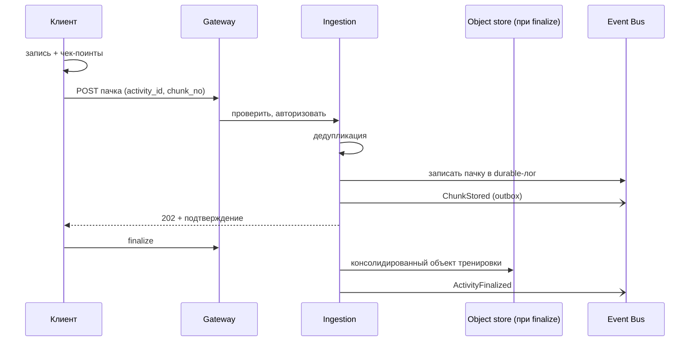

# UC-02. Запись тренировки (в т.ч. офлайн и с устройством)

[← Индекс](README.md)

- **Актор:** пользователь. **Цели:** BG-3; FR-AR-01…04, FR-DV-01; SC-1. **ADR:** 005, 009.
- **Предусловия:** разрешения на геолокацию/датчики, возможно подключён BLE-пульсометр.
- **Основной поток:** старт → запись в локальную БД с чек-поинтами каждые 10 с → завершение → постановка пачек в очередь → отправка → событие `ActivityFinalized` → сводка (UC-03).
- **Альтернативы:**
  - нет сети — очередь хранится до 7 дней, отправка при подключении;
  - ОС завершила процесс — при следующем запуске восстановление с последнего чек-поинта и предложение завершить;
  - потеря пульсометра — запись продолжается, на графике пометка;
  - пользователь вне домашнего региона — отправка на ближайший edge, пересылка в домашнюю ячейку (ADR-007).
- **Постусловия:** тренировка в Activity, пробег добавлен к инвентарю, события для Gamification/Notifications/Analytics.
- **Критерии:** потери < 0,1% (NFR-REL-02); батарея ≤ 8%/ч; дубликаты невозможны (NFR-REL-03).

