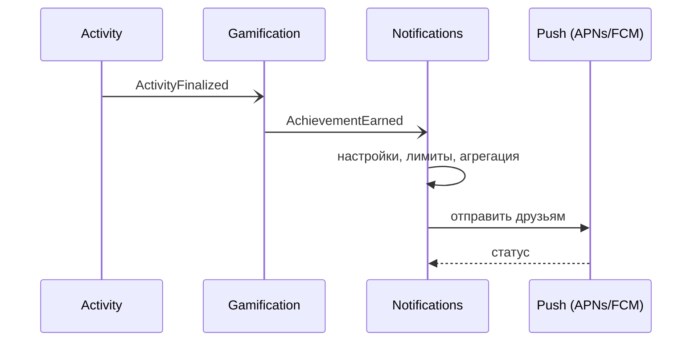

# UC-05. Достижение и уведомление друзей

[← Индекс](README.md)

- **Актор:** пользователь, его друзья. **Цели:** BG-1, BG-3; FR-GM-01, FR-NT-01/02, FR-SC-05; SC-3.
- **Основной поток:** `ActivityFinalized` → Gamification определяет достижение → событие `AchievementEarned` → Notifications проверяет настройки автора («делиться») и друзей, агрегирует, применяет лимиты и тихие часы → push/лента → друг ставит реакцию.
- **Альтернативы:** автор не разрешил делиться — только личное уведомление; друг превысил дневной лимит — агрегируется в дайджест; друг в другой ячейке — федеративная доставка карточки.
- **Критерии:** доставка p95 < 30 с; не более N (по умолчанию 5) уведомлений в день от социальных событий.

