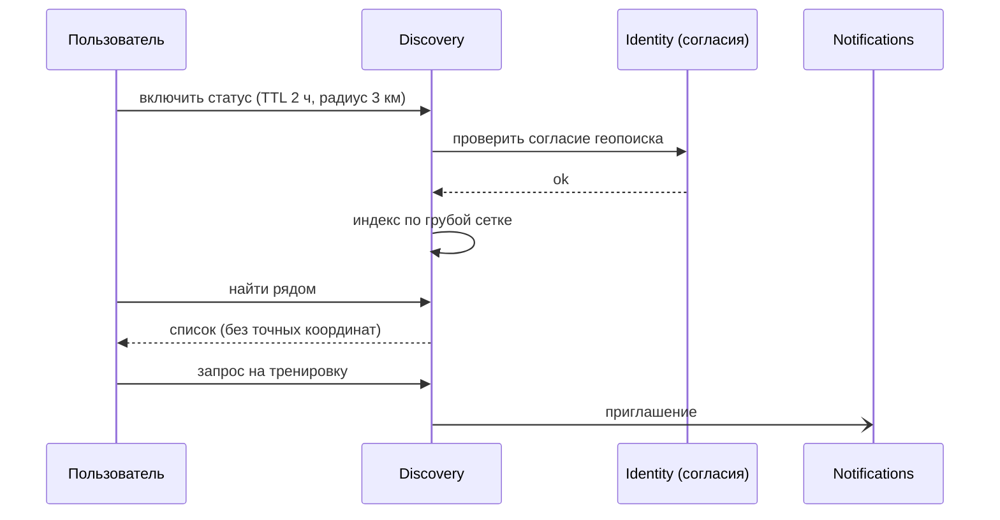

# UC-06. Поиск напарников (по интересам, месту, маршруту, «сейчас»)

[← Индекс](README.md)

- **Актор:** пользователь. **Цели:** BG-1, BG-4; FR-DS-01…04; SC-5. **ADR:** 007, 008.
- **Предусловия:** согласие «геопоиск»; взрослый профиль.
- **Основной поток:** выбор режима → (по месту/маршруту) система сопоставляет грубые индексы зон и сегментов → (сейчас) пользователь включает статус «открыт к тренировке» на 1–4 часа → список совпадений без точных координат → запрос → взаимное согласие → контакт через приложение/событие группы.
- **Альтернативы:** режим путешественника — запрос уходит в ячейку места через федерацию, возвращаются только публичные профили; жалоба/блокировка — мгновенное скрытие.
- **Защита:** точность до ячейки сетки ≥ 1 км; статус удаляется по TTL; нет отображения домашней зоны; лимит запросов в сутки.
- **Критерии:** 0 раскрытий точных координат; отклик p95 < 1,5 с.

