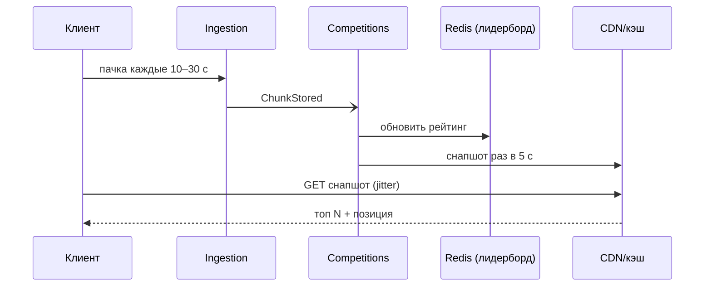

# UC-09. Участие в массовом соревновании

[← Индекс](README.md)

- **Актор:** участник, организатор. **Цели:** BG-1, BG-3; FR-CP-01/02, FR-GM-02; SC-4. **ADR:** 006, 009.
- **Предусловия:** регистрация открыта, участник зарегистрирован.
- **Основной поток:** регистрация → до старта экран ожидания → старт: клиент шлёт пачки каждые 10–30 с → Competitions обновляет рейтинг в sorted set → снапшот лидерборда раз в 5 с в кэш/CDN → клиент опрашивает снапшот → финиш → античит-проверка → итоговый протокол.
- **Альтернативы:** нет сети — запись продолжается локально, результат догружается после финиша; подозрительные данные — «на проверке» и исключение из топ-списков до решения; сбой ячейки — продолжение в той же ячейке, остальные не затронуты.
- **Критерии:** лидерборд отстаёт ≤ 10 с; 500 тыс. одновременно (A-5); ни одна запись не теряется.

