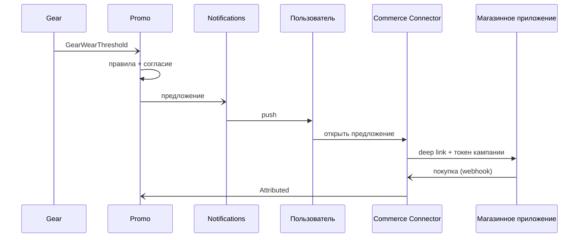

# UC-10. Персонализированное предложение и покупка

[← Индекс](README.md)

- **Актор:** пользователь, магазинное приложение. **Цели:** BG-2; FR-PM-01…04, FR-CM-01/02; SC-6. **ADR:** 010, 011.
- **Основной поток:** событие-триггер (износ обуви, тип тренировок, регион) → Promo подбирает кампанию по правилам и согласию → Notifications доставляет → пользователь открывает предложение → Commerce Connector формирует deep link с токеном кампании → магазинное приложение → покупка → возврат события атрибуции.
- **Альтернативы:** магазин недоступен — предложение скрывается или показывается как информация; нет согласия — только общие новости; кампания региональная — применяются региональные шаблоны и язык.
- **Критерии:** атрибуция ≥ 90% завершённых переходов; частота предложений ≤ лимита капа.

