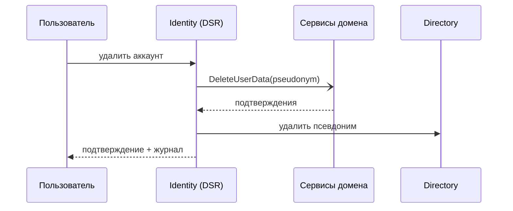

# UC-12. Экспорт и удаление данных, отзыв согласий

[← Индекс](README.md)

- **Актор:** пользователь/родитель, DPO. **Цели:** BG-4; FR-PR-01/02; SC-7. **ADR:** 008, 012.
- **Основной поток:** запрос в настройках → подтверждение личности → DSR-оркестратор создаёт сагу, рассылает команды сервисам (удаление/экспорт) → сервисы подтверждают → статистика пересчитывается без данных пользователя → уведомление об исполнении.
- **Альтернативы:** экспорт — архив с машиночитаемыми данными, ссылка действует 7 дней; удаление бэкапов — по расписанию ротации (≤ 35 дней); недоступен сервис — повторы, эскалация при превышении SLA.
- **Критерии:** срок ≤ 30 дней, цель ≤ 72 ч; журнал операций неизменяем.

