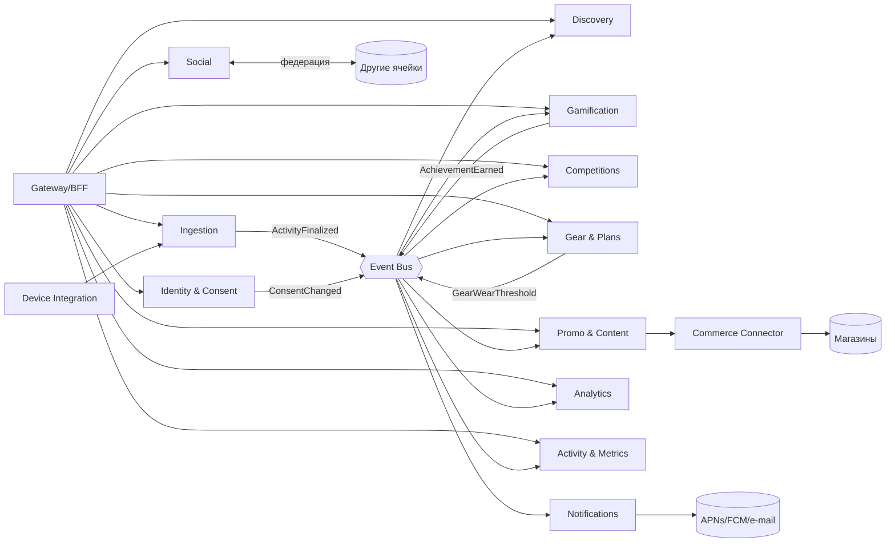

# 14a. Функциональное представление

[← Базовая архитектура](../13-base-architecture.md) · Далее: [информационное →](14b-information.md)

Показывает функциональные элементы, их обязанности и зависимости.

## Компонентная диаграмма (в рамках ячейки)

## Обязанности и границы

| Сервис | Отвечает за | Не отвечает за |
|---|---|---|
| Identity & Consent | Аккаунты, токены, возраст/родитель, согласия, DSR | Профиль активности, социальный граф |
| Ingestion | Приём и валидация пачек, дедупликация, сохранение сырых данных | Вычисление метрик, правила достижений |
| Activity & Metrics | Нормализация тренировок, метрики, рекорды, история | Сравнение с другими, визуальные правила ленты |
| Analytics & Benchmarks | Сравнения с собой/регионом/профи, перцентили, агрегаты | Оперативное хранение тренировок |
| Social | Группы, друзья, лента, комментарии, жалобы | Расчёт достижений, доставку push |
| Discovery | Индексы интересов/мест/маршрутов, статусы «сейчас» | Хранение точных треков |
| Notifications | Правила, агрегирование, лимиты, доставка | Бизнес-решения о достижениях/офферах |
| Gamification | Цели, значки, серии, челленджи | Соревнования масштаба «тысячи участников» |
| Competitions | Регистрация, лидерборды, античит, протоколы | Сохранение сырых данных |
| Gear & Plans | Инвентарь, износ, планы, календарь | Подбор рекламных предложений |
| Promo & Content | Кампании, правила таргетинга, капы, новости | Рассылку (делает Notifications), покупку |
| Commerce Connector | Адаптеры магазинов, deep link, атрибуция | Корзина, платежи |
| Device Integration | Коннекторы устройств, Health-импорты | Хранение сырых данных (передаёт в Ingestion) |

## Основные интерфейсы

| Интерфейс | Протокол | Потребитель → поставщик | Важное |
|---|---|---|---|
| Public API | REST/JSON, OIDC | Клиент → Gateway | Версионирование URL, лимиты, идемпотентные ключи |
| Sync API | REST (пачки, gzip/protobuf) | Клиент → Ingestion | Идемпотентный ключ activity_id+chunk_no |
| Internal API | gRPC/REST | Сервис → сервис | mTLS, таймауты, circuit breaker |
| Events | Kafka-совместимая шина, Avro/Protobuf | Сервис ↔ сервис | Schema registry, outbox, DLQ |
| Federation API | REST, подписанные токены | Ячейка ↔ ячейка | Минимальный набор полей |
| Adapter API | REST/webhook/пакеты | Commerce/Device ↔ внешние | Контрактные тесты, кэш, лимиты |
| Admin API | REST + UI | Консоли → сервисы | RBAC, аудит |

## Покрытие сценариев
UC-02 → Клиент, Ingestion, Activity; UC-05 → Gamification, Notifications; UC-06 → Discovery, Identity; UC-09 → Ingestion, Competitions, CDN; UC-10 → Gear, Promo, Notifications, Commerce Connector.
