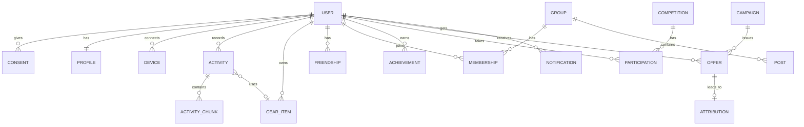

# 14b. Информационное представление

[← Функциональное](14a-functional.md) · [Оглавление](../../README.md) · Далее: [concurrency →](14c-concurrency.md)

## 1. Доменная модель (ядро)

## 2. Владение данными и хранение

| Данные | Владелец (сервис) | Хранилище | Класс | Хранение |
|---|---|---|---|---|
| Учётные данные, согласия, связи родитель–ребёнок | Identity | Реляционная | P3 | Пока аккаунт активен + журнал согласий по закону |
| Профиль, настройки приватности | Identity/Social | Реляционная | P2 | Пока аккаунт активен |
| Сырые телеметрические пачки (GPS, пульс) | Ingestion | Объектное (сжатые файлы) | **P3** | 24 мес. «тёплое», затем холодное по настройке; удаляется по DSR |
| Нормализованные тренировки и метрики | Activity | Реляционная | P3 | Пока аккаунт активен |
| Инвентарь и пробег | Gear | Реляционная | P2 | Пока аккаунт активен |
| Друзья, группы, посты, комментарии | Social | Реляционная + кэш | P2 | Посты — пока активна группа/аккаунт |
| Гео-индексы поиска и статусы | Discovery | Реляционная (гео) + Redis | P3 | Статусы TTL ≤ 4 ч; индексы пересобираются |
| Лидерборды, результаты | Competitions | Redis → реляционная | P2 | Результаты — по правилам события (публично) |
| Кампании, правила, отклики | Promo | Реляционная | P1 (кампании), P2 (отклики) | 24 мес. |
| Каталог товаров (копия) | Commerce Connector | Кэш | P0 | TTL |
| Агрегаты и бенчмарки | Analytics | Озеро + глобальная плоскость | P1 (анонимизированные) | 5 лет |
| Логи/метрики | Платформа | Бэкенд наблюдаемости | P1 (без PII) | 30–90 дней |
| Аудит доступа к PII | Платформа безопасности | Неизменяемое хранилище | P2 | ≥ 12 мес. |

**Классы данных:** P0 — публичные; P1 — внутренние/анонимные; P2 — персональные; P3 — особо чувствительные (геотреки, здоровье, идентификация, данные несовершеннолетних). Правила доступа и шифрования — [представление безопасности](14e-security.md).

## 3. Каталог событий (основные)

| Событие | Продюсер | Ключ партиции | Основные поля (без PII сверх необходимого) | Потребители |
|---|---|---|---|---|
| ConsentChanged | Identity | user_id | purpose, state, version | Promo, Discovery, Notifications, Analytics |
| ChunkStored | Ingestion | user_id | activity_id, chunk_no, uri | Competitions, Activity |
| ActivityFinalized | Ingestion | user_id | activity_id, sport, start/end, source | Activity, Gamification, Gear, Notifications, Discovery |
| ActivityComputed | Activity | user_id | activity_id, метрики, зоны, bounding-cell | Analytics, Gamification, Gear, Discovery |
| AchievementEarned | Gamification | user_id | type, level, share_scope | Notifications, Social |
| GearWearThreshold | Gear | user_id | gear_id, model, wear_pct | Promo |
| OfferIssued | Promo | user_id | campaign_id, offer_id | Notifications |
| Attributed | Commerce Connector | user_id | offer_id, order_ref | Promo, Analytics |
| CompetitionResultFinalized | Competitions | competition_id | результаты, статус античита | Social, Gamification |
| AccountDeleted | Identity | user_id | pseudonym | Все сервисы (сага DSR) |

Схемы — в registry (Avro/Protobuf), обратная совместимость обязательна ([ADR-009](../adr/ADR-009-idempotent-ingest.md)).

## 4. Потоки и преобразования

1. **Сырые → нормализованные:** пачки → Activity вычисляет трек, метрики, сглаживание (RSK-17) → нормализованная запись.
2. **Нормализованные → агрегаты:** Analytics в ячейке строит когортные агрегаты с k ≥ 50 → только они отправляются в глобальную плоскость.
3. **Бенчмарки → ячейки:** глобальные референсы (в т.ч. профессионалов, по лицензиям) реплицируются в ячейки.
4. **DSR:** AccountDeleted → каждый сервис удаляет данные и подтверждает; озеро — удаление по ключу с отложенным перестроением агрегатов.

## 5. Консистентность и целостность

| Данные | Модель |
|---|---|
| Идентичность, согласия | Сильная (в пределах ячейки) |
| Результаты соревнований | Сильная в момент финализации; во время live — eventual |
| Лента, уведомления, метрики, агрегаты | Eventual |
| Пробег инвентаря | Eventual, пересчёт идемпотентен |

## 6. Оценка объёмов (по модели [9.1](../09-nfr.md))

| Показатель | Год 1 | Год 2 | Год 5 |
|---|---|---|---|
| Сырая телеметрия (накопл., ТБ) | ≈ 15 | ≈ 60 | ≈ 380* |
| Нормализованные тренировки (млн записей) | ≈ 150 | ≈ 600 | ≈ 3 800 |
| Пользователи (млн) | 3 | 10 | 30 |

\* Накопленный объём без удаления; ретеншн и перевод в холодное хранение снижают стоимость, расчёт TCO — на этапе 3.
