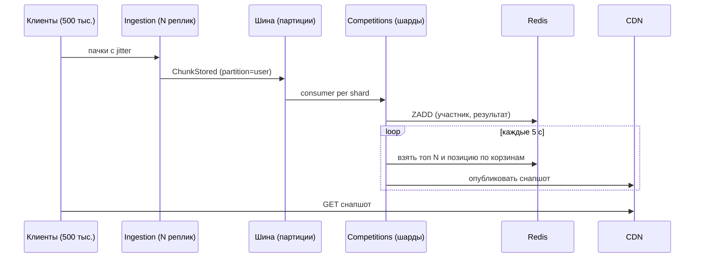

# 14c. Представление многозадачности (concurrency)

[← Информационное](14b-information.md) · [Оглавление](../../README.md) · Далее: [инфраструктурное →](14d-infrastructure.md)

## 1. Основные параллельные активности

| Контекст | Активность | Модель |
|---|---|---|
| Клиент | Поток записи сенсоров, поток хранения, воркер синхронизации, BLE-канал | Отдельные потоки/акторы; запись приоритетнее UI; чек-поинт каждые 10 с |
| Gateway | Обработка запросов | Асинхронный I/O, лимиты по клиенту |
| Ingestion | Приём пачек | Stateless, горизонтальное масштабирование; очередь записи в объектное хранилище |
| Консьюмеры событий | Activity, Analytics, Gamification, Notifications, Gear, Discovery | Consumer groups, параллелизм ≤ числа партиций |
| Competitions | Обновление рейтингов, снапшоты | Шардирование по (competition_id, bucket); один «писатель» на шард |
| Пакетные задачи | Агрегаты, пересчёт индексов, DSR | Планировщик (Kubernetes jobs) |

## 2. Порядок и идемпотентность

- Все события пользователя идут в одну партицию (ключ user_id) → порядок сохраняется внутри пользователя.
- Пачки тренировки имеют (activity_id, chunk_no); приём идемпотентен: повторная запись не изменяет состояние. Пачки могут приходить не по порядку — сборка по chunk_no, завершение подтверждается событием finalize + контрольная сумма.
- Потребители идемпотентны: таблица обработанных event_id или идемпотентные операции (upsert, max).
- Эффект «минимум один раз» плюс идемпотентность вместо «ровно один раз» ([ADR-009](../adr/ADR-009-idempotent-ingest.md)).

## 3. Транзакции и надёжная публикация

- **Outbox:** запись в БД и событие в одной локальной транзакции; релей публикует в шину.
- **Саги:** удаление данных (DSR), регистрация соревнования (Competitions → Gamification → Notifications), федеративное принятие в группу. Компенсирующие действия описываются в каждом сервисе.
- Распределённых транзакций (2PC) нет.

## 4. Обработка конкурентных обновлений

| Объект | Риск | Механизм |
|---|---|---|
| Пробег пары обуви | Две тренировки одновременно | Атомарный инкремент, версия строки |
| Счётчики реакций | Горячая запись | Счётчик в Redis + асинхронная фиксация |
| Членство в группе | Одновременные заявки/решения | Оптимистичная блокировка по версии |
| Лидерборд | Одновременные обновления участников | Sorted set, обновления по участнику через шард-писатель, приём только более новых значений |
| Статус «сейчас» | Старт/остановка | Redis с TTL, последний побеждает |
| Согласия | Изменение при параллельной обработке | Версия согласия; сервисы принимают только актуальную версию, события с меньшей версией отбрасываются |

## 5. Противодавление и защита от перегрузки

- Лимиты на пользователя/устройство/IP в Gateway; квоты ячейки на тяжёлые операции.
- Ingestion принимает пачки в очередь и подтверждает после надёжной записи; при росте задержки возвращает 429 с Retry-After и jitter — клиент уменьшает частоту.
- Консьюмеры автомасштабируются по лагу шины (например, KEDA); верхние пределы защищают БД.
- Circuit breaker и таймауты на вызовы внешних систем; деградация: скрыть блок, использовать кэш.
- Notifications: очереди по приоритетам (транзакционные > социальные > промо); промо-очереди сбрасываются первыми.

## 6. Горячие точки и их смягчение

| Горячая точка | Смягчение |
|---|---|
| Старт соревнования: одновременные пачки | Jitter старта на клиенте, предпрогрев, раздельный ingest-кластер, лимит регистраций |
| Знаменитость/группа с огромным числом подписчиков (fan-out) | Fan-out при чтении для крупных аккаунтов, push-доставка с агрегацией |
| Рассылка кампании | Разбивка на волны, лимит на минуту, капы по пользователю |
| DSR-пики | Очередь с ограничением параллелизма |

## 7. Сценарий live-соревнования (параллелизм)

