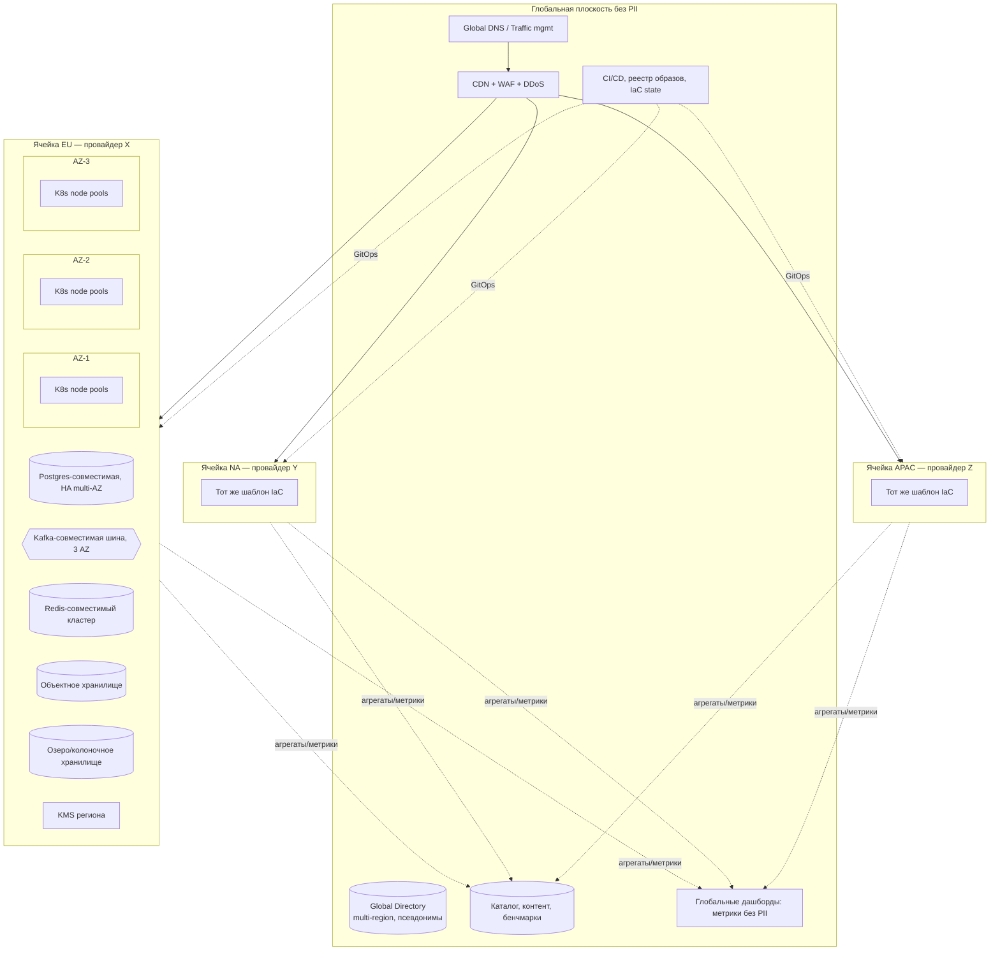

# 14d. Инфраструктурное представление

[← Concurrency](14c-concurrency.md) · [Оглавление](../../README.md) · Далее: [безопасность →](14e-security.md)

Принципы: [ADR-002](../adr/ADR-002-regional-cells.md) (ячейки), [ADR-003](../adr/ADR-003-cloud-strategy.md) (платформа), [ADR-013](../adr/ADR-013-event-bus-managed-services.md) (шина), [ADR-014](../adr/ADR-014-observability-slo.md) (наблюдаемость).

## 1. Топология

## 2. Состав ячейки

| Слой | Решение | Примечания |
|---|---|---|
| Вычисления | Kubernetes (managed), 3 зоны доступности, отдельные пулы: `ingest` (авто-масштаб), `core`, `batch`, `competitions` (предпрогрев) | Pod disruption budgets, topology spread |
| Сеть | VPC/VNet на ячейку; приватные подсети; доступ наружу через Gateway и WAF; egress через прокси с allow-list | Изоляция namespaces, network policies, mTLS (service mesh/sidecar-less) |
| Данные | Postgres-совместимая БД с synchronous replica в другой AZ; PITR; Redis-кластер с репликами; S3-совместимое хранилище с версионированием | Бэкапы — в том же регионе/юрисдикции |
| Шина | Kafka-совместимый кластер, 3 брокера минимум, replication factor 3 | Топики по доменам, ACL, DLQ |
| Ключи | KMS региона, ключи по классам данных, отдельные ключи для P3 | Ротация ≥ ежегодно |
| Наблюдаемость | OpenTelemetry collector → региональные бэкенды (метрики, логи, трейсы) | Глобально — только агрегированные метрики |
| Edge-приём | Принимающие узлы при CDN/регионах для «диких» мест: проксируют в домашнюю ячейку, буфер при недоступности | Только зашифрованный транзит, без постоянного хранения PII |

## 3. Размеры (ориентиры, ячейка «средняя»)

| Компонент | Год 1 | Год 2 | Год 5 |
|---|---|---|---|
| Пользователей в ячейке (млн MAU) | ≈ 1 | ≈ 3,5 | ≈ 10 |
| Узлов K8s (сред.) | 25–35 | 60–90 | 150–220 |
| БД (ядра/ГБ RAM, основной) | 32/256 | 64/512 + реплики чтения | шардирование по псевдониму |
| Redis | 3 шарда | 6 шардов | 12 шардов + отдельный под соревнования |
| Шина | 3 брокера, 24 партиции на топик | 6 брокеров, 96 | 9–12 брокеров, 192 |
| Объектное хранилище | ≈ 5 ТБ | ≈ 20 ТБ | ≈ 130 ТБ |

Это входные оценки для TCO (этап 3); уточняются нагрузочными тестами фазы 1.

## 4. Масштабирование и устойчивость

- Авто-масштабирование: HPA по CPU/RPS, KEDA по лагу шины, предпрогрев по расписанию крупных событий (UC-13).
- Отказ AZ: поды и данные переживают потерю одной зоны (NFR-REL-06); RTO ячейки ≤ 1 ч, RPO ≤ 5 мин (NFR-REL-04).
- Отказ ячейки: пользователи ячейки теряют доступ на время восстановления; клиент продолжает офлайн-запись; другие ячейки не затронуты.
- DR: восстановление из бэкапов и IaC в другом регионе той же юрисдикции; учения 2 раза в год.
- Деградация: отключение промо, снапшоты лидерборда из кэша, чтение ленты из кэша.

## 5. Развёртывание и среды

| Среда | Назначение |
|---|---|
| Dev | Разработка, эфемерные окружения по ветке |
| Stage (на ячейку) | Интеграции, контрактные тесты, нагрузочные тесты |
| Prod (на ячейку) | Канареечные релизы 1% → 10% → 100%, авто-откат по SLO |

CI/CD — единый конвейер, GitOps; IaC (Terraform) — модули «ячейка», «сервис». Новая ячейка: параметры региона/провайдера → pipeline → смоук-тесты ≤ 4 недель (NFR-SCL-06). Клиенты: фазированная публикация, remote config для региональных кампаний без релиза (NFR-MOD-02).

## 6. FinOps

Теги стоимости: ячейка, сервис, среда. Бюджеты и алёрты по ячейке. Главные драйверы затрат: объектное хранилище телеметрии (ретеншн), вычисления ingest и соревнований (пики), egress/CDN раздачи снапшотов, наблюдаемость. Меры: сжатие и колоночный формат, холодное хранение, спотовые узлы для batch, предпрогрев вместо постоянного резерва.
