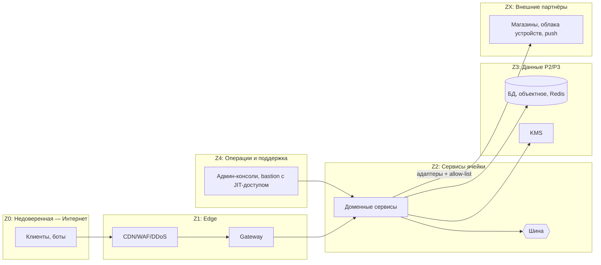

# 14e. Представление безопасности

[← Инфраструктурное](14d-infrastructure.md) · [Оглавление](../../README.md) · [Базовая архитектура](../13-base-architecture.md)

Основа: QA-1, [NFR-SEC-01…10](../09-nfr.md), [ADR-002](../adr/ADR-002-regional-cells.md), [ADR-007](../adr/ADR-007-cell-federation.md), [ADR-008](../adr/ADR-008-privacy-by-default.md), [ADR-012](../adr/ADR-012-identity-consent.md).

## 1. Зоны доверия

## 2. Аутентификация и авторизация

| Контур | Механизм |
|---|---|
| Пользователь → система | OIDC/OAuth 2.1 + PKCE; токены ≤ 15 мин, refresh с ротацией и привязкой к устройству; attestation устройства (App Attest/Play Integrity) для критичных операций |
| Сотрудники | SSO корпоративный, MFA, RBAC, JIT-доступ к производственным данным, согласование доступа к PII |
| Сервис → сервис | mTLS, сервисные идентичности (SPIFFE-подобные), минимальные права |
| Федерация между ячейками | Подписанные токены с узкими scope, список разрешённых методов |
| Приватность пользователя | ABAC: решение зависит от владельца, получателя, группы, согласия, возраста, цели |

## 3. Защита данных

| Класс | Транзит | Хранение | Доступ |
|---|---|---|---|
| P3 (треки, здоровье, возраст) | TLS 1.3 | AES-256, отдельные ключи KMS, шифрование на уровне приложения для сырой геотелеметрии | Только владелец и нужные сервисы; сотрудники — по запросу и JIT с аудитом |
| P2 (профили, посты) | TLS 1.3 | AES-256 | Сервисы-владельцы, модераторы по задаче |
| P1/P0 | TLS | Стандартно | Широкий, без PII |

Дополнительно: токенизация/псевдонимы вне ячейки (Directory знает только псевдоним), маскирование зон приватности на сервере, минимизация полей в событиях, запрет PII в логах (сканеры в CI и рантайме).

## 4. Модель угроз (STRIDE/LINDDUN, верхний уровень)

| Угроза | Вектор | Меры | НФТ / ADR |
|---|---|---|---|
| Раскрытие места проживания по трекам | Публичные посты, поиск людей | Зоны приватности, грубая сетка, приватность по умолчанию | SEC-03; ADR-008 |
| Деанонимизация через статистику | Малые когорты | k ≥ 50, укрупнение | SEC-07; ADR-008 |
| Захват аккаунта | Утечка паролей, фишинг | Passkeys/MFA-опция, обнаружение аномалий, ротация токенов | SEC-04 |
| Подмена данных тренировки/читерство | Эмулятор GPS, подделка пачек | Attestation, проверка правдоподобия, подписи пачек | FR-CP-02; ADR-009 |
| Доступ злоумышленника к одному сервису | Уязвимость в сервисе | mTLS, network policies, минимальные права, изоляция БД | SEC-05 |
| Злоупотребление сотрудников | Доступ к PII | JIT, аудит, обзоры доступа, разделение обязанностей | SEC-05; OBS-04 |
| Нарушение резидентности | Ошибочная репликация данных | Политики (OPA) на уровне платформы, запрет cross-region egress для P3, проверки в CI | SEC-02; ADR-002 |
| Контакты с несовершеннолетними | Поиск людей, личные сообщения | Закрытые профили, нет геопоиска, модерация, отсутствие ЛС (фаза 1–3) | SEC-08; ADR-008 |
| Отказ в обслуживании | Всплеск трафика, бот-регистрации | WAF, rate limits, CAPTCHA/anti-bot, квоты | SCL-02 |
| Утечка через интеграции | Партнёры, SDK | Allow-list, минимизация данных партнёрам, договоры, контрактные тесты | MOD-04; ADR-010 |
| Цепочка поставок | Библиотеки, образы | SBOM, подписи образов, сканирование, закреплённые версии | NFR-SEC-09 |
| Спам и злоупотребление промо | Накрутка, фишинг через промо | Ролевая публикация, модерация шаблонов, лимиты | ADR-011 |

## 5. Приватность и соответствие

- Привязка согласий к целям и версиям текста, журнал; отзыв применяется ≤ 24 ч во всех сервисах (через `ConsentChanged`).
- DPIA (оценка воздействия на защиту данных) обязательна для фаз 1, 2 (поиск людей) и 3 (режим «сейчас»).
- Карта соответствия по юрисдикциям (GDPR, UK GDPR, CCPA/CPRA, LGPD, PIPL, 152-ФЗ и др.) ведётся DPO; для каждой ячейки — реестр обработок (RoPA).
- Права субъектов: доступ, исправление, экспорт, удаление, возражение — UC-12.
- Дети: возрастной порог по юрисдикции, родительское согласие, запрет таргетинга.

## 6. Безопасная разработка и эксплуатация

- Secure SDLC: моделирование угроз перед фазой, SAST/DAST/SCA в CI, ревью безопасности для сервисов P3, pentest перед запуском и ежегодно, bug bounty.
- Секреты — в хранилище секретов, без секретов в репозитории; автоматическая ротация.
- Журналирование безопасности: неизменяемый аудит доступа к P3, обнаружение аномалий, SIEM на ячейку.
- Реагирование на инциденты: runbook, дежурство, уведомление регуляторов по срокам закона (например, 72 ч по GDPR), учения.
- Резервные копии: шифрование, тест восстановления, хранение внутри юрисдикции.

## 7. Остаточные риски (передаются на этап 3)
Допустимые отклонения и остаточные риски (RSK-03, 04, 06, 20) будут оценены в анализе рисков архитектуры.
